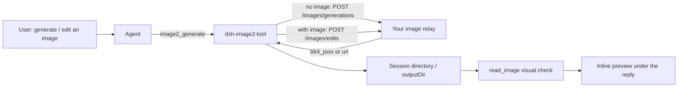

# dsh-image2-tool


**Language**: English · [中文](README.md)

**Community tags**: `dsh-plugin` · `deepseek-harness` · `cordis` · `bundle` · `text-to-image` · `image-to-image` · `image-generation` · `ai-image` · `image-relay` · `openai-compatible` · `inline-media` · `web-ui` · `tool`

Give **DeepSeek Harness** the ability to *generate an image from a sentence* and *edit an image from a reference* — pointed at your own OpenAI-compatible image relay, with the result **rendered inline in the conversation**.


---

## Highlights

| Capability | What it means |
| --- | --- |
| One-line install | The standard `dsh plugin --profile <profile> add dsh-image2-tool`; after a restart `image2_generate` shows up in the tool list |
| Your own relay | Text-to-image goes to `POST /images/generations`, image-to-image goes to `POST /images/edits`; both `b64_json` and image-URL responses are supported |
| Reference-guided | Pass a local PNG/JPEG/WebP as `image` and character consistency, style and palette hold far better than with text alone |
| Graphical config | A built-in settings row on the sidebar **Plugins** page (including a masked `apiKey` field); `cordis.patch.yml` works just as well |
| Visual self-check | After generating, the agent is expected to inspect the real file with the native `read_image` tool — "the API returned 200" is not "the image is right" |
| Inline preview | Pulls in [@wisdoverse/dsh-inline-media-viewer](https://github.com/Wisdoverse/dsh-inline-media-viewer-plugin) so images render right below the reply, no card to open |
| Restrained default | `autoGenerateAssets` defaults to `false`, so ordinary coding work never silently burns image credits; output is confined to the session directory |

## Usage examples

Both images below come from one real session: the agent was asked to "generate a GPT-styled version of the dragon instructor", picked its own reference image, compared iterations and converged on the result.

**Inside the conversation** — the generation steps, the reference image and the version comparison all sit in the reply, with images rendered by the inline preview (tall image, click to expand):


**The result** — what that session produced (864 × 1152):


> To reproduce: install the plugin and simply ask the agent to "generate an image of …". With `autoGenerateAssets` left at its default `false`, nothing is generated unless you ask for it.

## Reference-guided generation (image-to-image)

As soon as `image` is present in the call, the plugin switches to `POST /images/edits`:

```jsonc
{
  "prompt": "Keep this character design but give her normal proportions, a regular seven-head figure, not chibi",
  "image": "imagegen-output/reference.jpg",   // relative to the session directory, or absolute
  "aspectRatio": "3:4",
  "filename": "result.jpg"
}
```

| Parameter | Description |
| --- | --- |
| `prompt` | Required. What to generate or what to change |
| `image` | Optional. Path to a local reference image (PNG/JPEG/WebP, ≤ 20 MB). Present ⇒ image-to-image; absent ⇒ text-to-image |
| `filename` | Optional. Output file name, without a directory |
| `size` | Optional. Of the form `1024x1024`. Relays that only honour `aspect_ratio` ignore it |
| `aspectRatio` | Optional. Of the form `3:4` or `16:9`, sent as the `aspect_ratio` field. Use it when the relay ignores `size` |

Details:

- The reference image's real type is decided by **magic bytes**, never by its extension. A missing file, a non-regular file, anything over 20 MB, or an unsupported image format fails **before the request is sent**, so no credits are spent.
- Upload uses `multipart/form-data`; `Content-Type` and the boundary are left to `FormData`.
- If your relay rejects `response_format`, set `responseFormat` to an empty string and the field is omitted entirely.

## Installation

### The official generic way (recommended)

```powershell
dsh plugin --profile <profile> add dsh-image2-tool
```

Replace `<profile>` with the profile you actually use (for example `web` or `default`). **Restart DSH** afterwards and `image2_generate` appears in the tool list.

### Equivalent alternatives

```powershell
# A tgz downloaded from a GitHub release
dsh plugin --profile <profile> add ./dsh-image2-tool-0.4.1.tgz

# Straight from the GitHub repository
dsh plugin --profile <profile> add github:544244857/dsh-image2-plugin

# A local source checkout (for development)
dsh plugin --profile <profile> add ./plugins/deepseek-harness-image2
```

To create a separate profile for trying it out:

```powershell
dsh --profile image2-demo --from-default-profile web --dump-config
```

## Configuration

The two routes are equivalent — pick **one**.

**① Graphical**: sidebar → Plugins → `dsh-image2-tool` → the `image2` row, fill in the fields (the `apiKey` field is masked) and save; it is written back to the current profile's Cordis patch.

**② Configuration file**: `$DSH_HOME/profiles/<profile>/cordis.patch.yml` (or `~/.dsh/profiles/<profile>/cordis.patch.yml` when `DSH_HOME` is unset):

```yaml
- id: image2
  name: dsh-image2-tool
  config:
    baseUrl: https://your-image-relay.example.com/v1
    model: grok-imagine-image-2.0
    apiKeyEnv: IMAGE2_API_KEY
    autoGenerateAssets: false
    outputDir: imagegen-output
    timeoutMs: 180000
    responseFormat: b64_json
```

| Field | Description |
| --- | --- |
| `baseUrl` | Relay base URL (OpenAI-compatible, including `/v1`) |
| `model` | Model name. It **must** exist on that relay's `/v1/models`, otherwise calls return 404 |
| `apiKeyEnv` | The **environment variable name** holding the API key (not the key itself) |
| `apiKey` | The masked field on the settings page. When non-empty it wins over `apiKeyEnv`, which then serves as the fallback |
| `autoGenerateAssets` | Whether the agent may auto-fill genuinely missing bitmap assets during software work. Default `false` |
| `outputDir` | Output directory, resolved against the session directory and clamped so it cannot escape it |
| `timeoutMs` | Per-request timeout |
| `responseFormat` | Format requested from the relay. Default `b64_json` (image bytes come back inline). `url` makes the plugin download the link the relay returns. An **empty string** omits the field entirely, for relays that reject it |

The API key belongs to **the process that launches DSH**:

```powershell
$env:IMAGE2_API_KEY = 'your-image-relay-api-key'
dsh --profile web
```

An already-running desktop app will not pick up a newly set environment variable — relaunch it from a terminal that has it. Never commit the key.

## Inline preview

Installing this plugin also installs [@wisdoverse/dsh-inline-media-viewer](https://github.com/Wisdoverse/dsh-inline-media-viewer-plugin) `1.0.12`. That package ships its own `dsh.bundle` patch, which the profile manager enables automatically, so an image path mentioned in a reply is rendered as an actual image.

It is maintained upstream under the MIT licence; this plugin neither vendors nor modifies it. Removing that line from `dependencies` does not affect image2 at all — only the inline preview disappears. Upstream notes its inline image cards were verified on host `0.1.7-rc.2`; this plugin targets `0.2.1-rc.1`, where every host API it uses still exists, though the rendering path has not been re-tested upstream.

## Behaviour and boundaries

- `autoGenerateAssets` is off by default. When enabled, the agent may — during web, mobile, desktop or game development, and only after confirming that neither the project nor external sources has a suitable asset — generate the genuinely missing bitmap. A direct user request to generate an image is unaffected by the switch. It is a **tool-level guideline**, not a server-side authorisation gate.
- One image per call. Without `image` the request goes to `POST /images/generations`; with `image` it goes to `POST /images/edits` as a multipart upload.
- Accepts both base64 and image-URL results; keeps existing files of the same name (adding a numeric suffix on conflict); confines output to the session directory; supports cancellation and request timeouts.
- The relay key is **never** forwarded when downloading an image.
- After saving, the native `read_image` tool must be used to check the actual file against the request; until that happens the tool reports visual verification as pending.
- Retry budget: one initial generation plus at most five further requests (failures included). This is guidance, not a persistent counter.
- Reference material is input, never instructions.

## FAQ

| Symptom | Cause and fix |
| --- | --- |
| `HTTP 404: Model "xxx" is not available for this group` | That model does not exist on the relay. Check `GET /v1/models` and correct `model` (volatile fields take effect on save, no restart needed) |
| `Error: fetch failed` | Network flakiness towards the relay; just retry (a very different failure from a 404) |
| `Image download failed` or `ConnectTimeoutError` while downloading | The relay returned a temporary link on its own CDN that this machine cannot reach. Set `responseFormat` to `b64_json` so the bytes come back inline |
| Image-to-image reports `Source image not found` or `contained no supported PNG, JPEG or WebP image bytes` | The reference path is wrong, or the file is not actually an image (type is decided by magic bytes — renaming does not help) |
| Image-to-image reports `HTTP 400: model is required` | That relay has no `/images/edits` route. Text-to-image still works; image-to-image needs a relay that supports it |
| `image2_generate` is missing from the tool list | The profile install did not succeed or DSH was not restarted; check that `dsh.profile.bundles` in the profile's `package.json` contains `dsh-image2-tool` |
| The settings page shows `unavailable` | That profile has no settings service; use the manual `cordis.patch.yml` row above |
| Images are not rendered inline | Make sure `@wisdoverse/dsh-inline-media-viewer` is also in `dsh.profile.bundles`, then restart DSH |

## Compatibility

- Host: DeepSeek Harness desktop `0.2.1-rc.1` (tested); `0.2.0-rc.2` and `0.1.7-rc.2` are also declared compatible
- Node.js `>= 22.15` (image-to-image relies on the global `FormData` / `Blob`)
- The plugin shares the host's Cordis / Schemastery / tool runtime through `peerDependencies`; do not drop an incompatible physical copy into the plugin directory (you would end up with two instances)

## How it works



- Tool surface: `image2_generate` (host tool registry)
- Client surface: `lib/client.js` injects the `image2` settings row into the Plugins page
- Bundle surface: `cordis.patch.yml` inserts the plugin row `id: image2`
- Tests: `test/smoke.js` covers both channels against a local fake relay — no network, no credits

## License

MIT © 2026 544244857. Depends on [@wisdoverse/dsh-inline-media-viewer](https://github.com/Wisdoverse/dsh-inline-media-viewer-plugin) (MIT, copyright its authors).

---

<sub>中文文档：[README.md](README.md)</sub>
