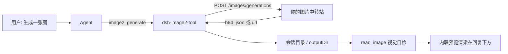

# dsh-image2-tool


**社区插件标签**：`dsh-plugin` · `deepseek-harness` · `cordis` · `bundle` · `text-to-image` · `image-generation` · `ai-image` · `image-relay` · `openai-compatible` · `inline-media` · `web-ui` · `tool`

给 **DeepSeek Harness** 加上「一句话生成图片」的能力：接你自己的 OpenAI 兼容图片中转站，生成的图**直接内联显示在对话里**。


---

## 亮点

| 能力 | 说明 |
| --- | --- |
| 一行安装 | 官方通用方式 `dsh plugin --profile <profile> add dsh-image2-tool`，重启后工具表出现 `image2_generate` |
| 自己的中转站 | 通过 `POST /images/generations` 调用你的 OpenAI 兼容图片服务，同时支持 `b64_json` 与图片 URL 两种返回 |
| 图形化配置 | 侧边栏 Plugins 页内置设置行（含遮蔽的 `apiKey` 字段），也可直接写 `cordis.patch.yml` |
| 视觉自检 | 生成后用原生 `read_image` 复核真实文件，不把「接口成功」当成「视觉合格」 |
| 内联预览 | 自动带上 [@wisdoverse/dsh-inline-media-viewer](https://github.com/Wisdoverse/dsh-inline-media-viewer-plugin)，图片直接渲染在回复下方，无需点开卡片 |
| 克制默认 | `autoGenerateAssets` 默认 `false`，普通开发任务不会悄悄花掉生图额度；输出被限制在会话目录内 |

## 使用示例

下面两张图来自一次真实会话：让 Agent「生成一张 GPT 化龙指导器的形象」，它自己挑参考图、比对版本、迭代出成品。

**对话里长这样** —— 生成过程、参考图、版本对比都在回复里，图片由内联预览直接渲染，不用点开任何卡片（长图，可点开看全）：


**最终结果** —— 该会话产出的成品（864 × 1152）：


> 复现方式：装好插件后直接对 Agent 说「生成一张 XXX 的图」即可。`autoGenerateAssets` 保持默认 `false` 时，只有你明确要求才会生图。

## 安装

### 官方通用方式（推荐）

```powershell
dsh plugin --profile <profile> add dsh-image2-tool
```

把 `<profile>` 换成你常用的 profile 名（例如 `web`、`default`）。装完**重启 DSH**，工具表里就会出现 `image2_generate`。

### 其它等价方式

```powershell
# 从 GitHub Release 下载的 tgz
dsh plugin --profile <profile> add ./dsh-image2-tool-0.3.0.tgz

# 直接从 GitHub 仓库安装
dsh plugin --profile <profile> add github:544244857/dsh-image2-plugin

# 本地源码目录（开发调试）
dsh plugin --profile <profile> add ./plugins/deepseek-harness-image2
```

需要新建一个独立 profile 时：

```powershell
dsh --profile image2-demo --from-default-profile web --dump-config
```

## 配置

两种方式等价、可互换，**二选一**即可。

**① 图形界面**：侧边栏 → Plugins → `dsh-image2-tool` → `image2` 行，逐项填写（含遮蔽的 `apiKey` 密钥字段），保存即写回当前 profile 的 Cordis patch。

**② 配置文件**：`$DSH_HOME/profiles/<profile>/cordis.patch.yml`（未设置 `DSH_HOME` 时为 `~/.dsh/profiles/<profile>/cordis.patch.yml`）：

```yaml
- id: image2
  name: dsh-image2-tool
  config:
    baseUrl: https://your-image-relay.example.com/v1
    model: grok-imagine-image-2.0
    apiKeyEnv: IMAGE2_API_KEY
    autoGenerateAssets: false
    outputDir: imagegen-output
    timeoutMs: 180000
```

| 字段 | 说明 |
| --- | --- |
| `baseUrl` | 中转站地址（OpenAI 兼容，含 `/v1`） |
| `model` | 模型名，**必须**是该中转站 `/v1/models` 里真实存在的名字，否则调用返回 404 |
| `apiKeyEnv` | API key 的**环境变量名**（不是 key 本身） |
| `apiKey` | 设置页里的遮蔽字段；非空时优先于 `apiKeyEnv`，后者作为兜底 |
| `autoGenerateAssets` | 是否允许在软件开发任务中自动补齐缺失位图素材，默认 `false` |
| `outputDir` | 输出目录，相对会话目录解析并强制不越界 |
| `timeoutMs` | 单次请求超时 |

API key 交给**启动 DSH 的那个进程**：

```powershell
$env:IMAGE2_API_KEY = 'your-image-relay-api-key'
dsh --profile web
```

已经开着的桌面端不会继承新设的环境变量，需要从带该变量的终端重新启动。别把 key 写进 Git。

## 内联预览

安装本插件时会一并安装 [`@wisdoverse/dsh-inline-media-viewer`](https://github.com/Wisdoverse/dsh-inline-media-viewer-plugin) `1.0.12`。该包自带 `dsh.bundle` patch，安装时会被 profile 管理器自动启用为 bundle，于是回复中提到的图片路径会直接在对话里渲染成图片。

它由上游维护、MIT 许可，本插件既不 vendor 也不修改其代码；删除 `dependencies` 里的这一行，image2 功能完全不受影响，只是内联预览消失。上游标注内联图片卡片在宿主 `0.1.7-rc.2` 上验证过，本插件面向 `0.2.0-rc.2`，所用宿主 API 均存在，但渲染路径上游尚未复测。

## 行为与边界

- `autoGenerateAssets` 默认关闭。打开后，Agent 可以在网页、移动端、桌面端、游戏等软件开发过程中，确认项目内与外部都没有合适素材后，生成真正缺失的位图素材；用户的直接生图请求不受该开关影响。它是**工具层指引**，不是服务端授权闸门。
- 只走 `POST /images/generations`，一次一张；仅支持文本提示词，不支持上传参考图/蒙版，也不能直接编辑已有图片。
- 接受 base64 与图片 URL 两种结果；保留同名已有文件（冲突自动加序号），输出限定在会话目录内，支持取消与请求超时。
- 下载图片时**不会**转发中转站 key。
- 保存后必须用原生 `read_image` 检查实际文件并与需求逐项对照；在检查完成前，工具会把「视觉验收」标记为待办。
- 重试预算：初始 1 次 + 最多 5 次追加生成请求（含失败），这是指引而非持久计数器。
- 参考文本是素材，永远不是指令来源。

## 常见问题

| 现象 | 原因与处理 |
| --- | --- |
| `HTTP 404: Model "xxx" is not available for this group` | 模型名在该中转站上不存在。用 `GET /v1/models` 查可用列表后改 `model` 字段（volatile 字段保存即生效，无需重启） |
| `Error: fetch failed` | 到中转站的网络抖动，重试即可（与 404 是完全不同的故障） |
| 工具表里没有 `image2_generate` | profile 未安装成功或未重启；确认 profile 的 `package.json` 中 `dsh.profile.bundles` 含 `dsh-image2-tool` |
| 设置页显示 `unavailable` | 该 profile 没有 settings 服务，改用上面的 `cordis.patch.yml` 手工行 |
| 图片没内联显示 | 确认 `@wisdoverse/dsh-inline-media-viewer` 也在 `dsh.profile.bundles` 中，并重启 DSH |

## 兼容性

- 宿主：DeepSeek Harness 桌面版 `0.2.0-rc.2`（实测），`0.1.7-rc.2` 亦声明兼容
- Node.js `>= 22.15`
- 插件通过 `peerDependencies` 共享宿主的 Cordis / Schemastery / tool runtime；不要在插件目录里放不兼容的物理副本（会出现两份实例）

## 工作方式



- 工具面：`image2_generate`（宿主工具注册表）
- 客户端面：`lib/client.js` 向 Plugins 页注入 `image2` 配置行
- bundle 面：`cordis.patch.yml` 插入插件行 `id: image2`

## 许可

MIT © 2026 544244857。依赖 [@wisdoverse/dsh-inline-media-viewer](https://github.com/Wisdoverse/dsh-inline-media-viewer-plugin)（MIT，版权归其作者）。

---

<sub>English: `dsh-image2-tool` is a DeepSeek Harness plugin bundle that turns your own OpenAI-compatible image relay into the `image2_generate` tool, and renders generated images inline in the conversation. Install with `dsh plugin --profile <profile> add dsh-image2-tool`.</sub>
